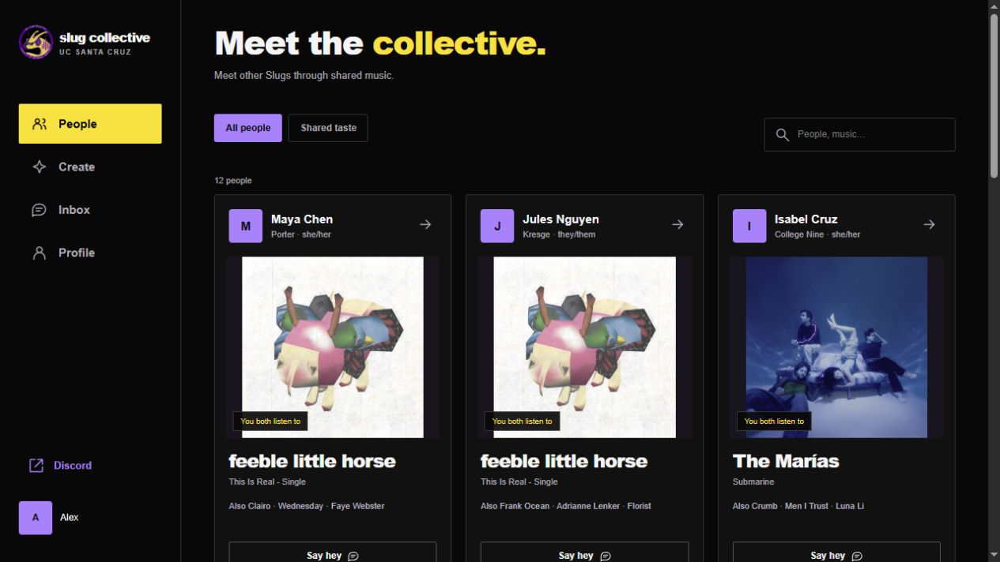
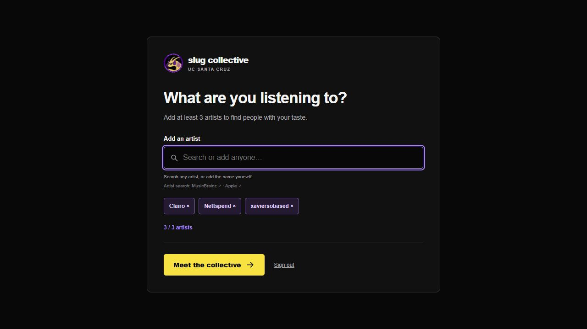
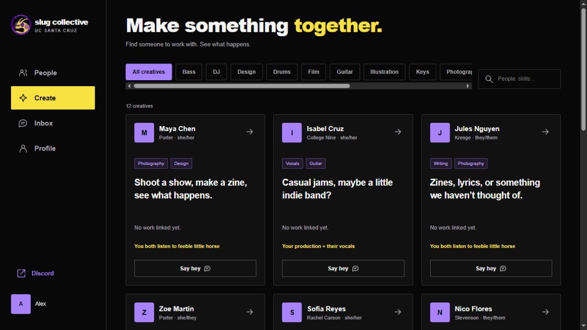
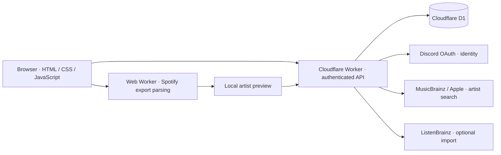

# Slug Collective

### A music-first community app for UC Santa Cruz students.

Discover people through the artists you actually listen to, find collaborators across creative disciplines, and start a conversation with something in common.

[Live application](https://beta.slugcollective.workers.dev/) · [Architecture](#architecture) · [Local development](#local-development) · [Technical documentation](#technical-documentation)



> The live beta requires Discord sign-in and a club application invite. Screenshots use fictional members in an isolated local database; they do not expose real member profiles or conversations.

## Why I built it

As president of the Slug Collective, I wanted to make it easier for people in our creative community to meet. A shared niche artist can be a much better conversation starter than a generic interest tag. Finding someone to make music, shoot a show, or design a cover with should feel equally approachable.

The result is a focused product with two discovery modes: **People** for shared listening and **Create** for creative collaboration. It is built around the club's identity, with a mobile-first interface and a short path from joining to starting a conversation.

## Product experience

| Flow | What members can do |
| --- | --- |
| **Join** | Sign in with Discord and a club invite, then choose at least three distinct artists during first-time setup. |
| **People** | Browse profiles ranked by shared artists, search by name or music, and see concrete reasons for a connection. |
| **Create** | Discover musicians, producers, photographers, designers, and other creatives; filter by role and explore collaboration interests. Participation is opt-in. |
| **Inbox** | Start a conversation from an artist or creative project, with that context carried into a persistent private thread. |
| **Profile** | Edit music and creative interests, import listening data, and manage account settings. |

| First-time artist setup | Creative collaboration |
| --- | --- |
|  |  |

## Engineering highlights

- **Explainable recommendations.** Shared artists are weighted by how uncommon they are within the community. Create adds complementary creative roles. Recommendations surface the shared artist or skill pairing instead of an arbitrary match percentage.
- **Privacy-conscious Spotify imports.** ZIP and JSON exports are parsed in a browser Web Worker. Members review the extracted artists before saving; raw archives and unrelated account fields stay on the device. The server accepts validated artist aggregates.
- **Resilient artist discovery.** MusicBrainz search falls back to Apple's artist catalog. Debouncing, cancellation, stale-response protection, bounded requests, and separate provider budgets keep search usable. Custom names remain available.
- **Layered caching.** Shared D1 results last seven days, including reuse of exact artist names found in earlier results. A bounded browser catalog remembers up to 500 public artist records for 30 days and supplies immediate partial-name suggestions across visits.
- **Persistent, authorized messaging.** Every conversation request checks participation. A database uniqueness constraint makes retried sends idempotent. Member blocking, reporting, account deletion, and administrator-created invites are implemented.
- **A small frontend with explicit state.** Vanilla JavaScript, semantic HTML, and responsive CSS keep the interface framework-light. Music parsing runs off the main thread; matching logic is separate from rendering and integration code.

## Recommendation approach

The current recommender is a deterministic baseline, **not a trained ML model**. For a shared artist, its contribution is:

```text
artist weight = 1 + ln((community size + 1) / (artist listener count + 1))
```

People ranking sums those contributions. Create also rewards predefined complementary role pairs, such as production and vocals. Names are normalized for case, Unicode, and whitespace; stable tie-breaking keeps ordering predictable.

This favors meaningful niche overlap without hiding the reasoning. Recommendation feedback is stored for future evaluation. A next step is to compare this baseline against learned artist representations using opt-in relevance feedback and a defined evaluation protocol, rather than assume a more complex model is better.

## Architecture



| Layer | Implementation |
| --- | --- |
| Interface | Vanilla JavaScript, responsive CSS, bundled club artwork and cover assets |
| Runtime | Cloudflare Workers; esbuild bundles the server and static assets |
| Persistence | Cloudflare D1 / SQLite; Drizzle schema and versioned SQL migrations |
| Identity | Discord OAuth with application invites for initial registration |
| Music | Manual artist selection, Spotify export import, optional ListenBrainz import |
| Development | Node.js 22+, Miniflare, Wrangler, npm |
| Verification | Node's test runner, isolated D1 integration tests, UI state tests, and GitHub Actions |

```text
web/          Interface, matching, music import worker, and bundled assets
server/       Authentication, member APIs, messaging, and catalog integrations
db/           Drizzle schema
drizzle/      Versioned database migrations
scripts/      Build, local development, tests, and deployment helpers
tests/        Authentication, authorization, imports, caching, matching, and UI state
docs/         Integration guides, security notes, and screenshots
```

## Security and data boundaries

Discord proves control of an identity; a separate application invite gates initial registration. OAuth state is single-use. Session and invite bearer values are hashed in storage, and sessions use HTTP-only, SameSite cookies with Secure enabled over HTTPS. Authenticated writes require both a matching origin and a CSRF token.

Database queries are parameterized, submitted fields are validated, and upstream requests have size and timeout limits. Artist search forwards the typed query, not member profiles or messages. ListenBrainz tokens verify ownership once and are discarded.

Private conversations are protected by server-side participant checks; they are **not end-to-end encrypted**. The [security notes](docs/SECURITY.md) document the trust boundaries and operational considerations.

## Local development

**Prerequisites:** Node.js 22 or newer, npm, and a Discord developer application for real sign-in.

```bash
git clone https://github.com/LuizCauet/slug-collective.git
cd slug-collective
npm ci
```

Copy `.env.example` to `.dev.vars`, fill in the required values, and register the local callback using the [Discord setup guide](docs/DISCORD_SETUP.md). Keep `.dev.vars` out of version control.

```bash
npm run dev
```

Open **http://127.0.0.1:5174**. Local development uses an isolated D1 database; it does not copy production members or conversations. First-time registration requires an application invite, followed by artist setup. There is no production authentication bypass.

| Command | Purpose |
| --- | --- |
| `npm run check` | Check server and browser JavaScript syntax |
| `npm test` | Run the automated regression suite |
| `npm run build` | Bundle the Worker and static assets |
| `npm run deploy` | Apply remote D1 migrations and deploy through Wrangler |

Deployment requires authorization to the intended Cloudflare account. Follow the [Cloudflare guide](docs/CLOUDFLARE.md) before running remote commands.

## Validation and current scope

The current suite contains **85 passing automated tests**, covering OAuth state and invites, CSRF and access control, conversation isolation and retry behavior, onboarding, provider failures, shared caches, malformed Spotify archives, recommendation ordering, and UI state transitions. Integration tests run the application against isolated D1 databases with the actual migrations; external identity and music services are mocked for repeatable tests.

Browser checks additionally cover the onboarding-to-discovery flow and persistence after refresh. Automated UI state tests are not a full browser end-to-end suite.

The application is a deployed club beta. Current tradeoffs are explicit:

- Recommendations use rules and community frequency, with no trained model or claimed recommendation-quality metrics yet.
- Listening imports are user-initiated; Spotify uses exported files rather than direct OAuth or continuous synchronization.
- Inbox updates use polling and show the newest 200 messages; older-history pagination and push notifications are future work.
- Artist identity is primarily name-based; canonical IDs across import sources and same-name disambiguation need further work.
- Broad rollout still needs operational work around moderation, retention, and backup/restore procedures.

## Technical documentation

[Onboarding](docs/ONBOARDING.md) · [Artist search and caching](docs/ARTIST_SEARCH.md) · [Spotify imports](docs/SPOTIFY_IMPORT.md) · [ListenBrainz](docs/MUSIC.md) · [Discord setup](docs/DISCORD_SETUP.md) · [Deployment](docs/CLOUDFLARE.md) · [Security](docs/SECURITY.md)

---

Built for the Slug Collective by [LuizCauet](https://github.com/LuizCauet). A student-led project, independent of official UC Santa Cruz services. Club branding and third-party music artwork belong to their respective owners; bundled cover sources are recorded in `web/music-art.js`.
